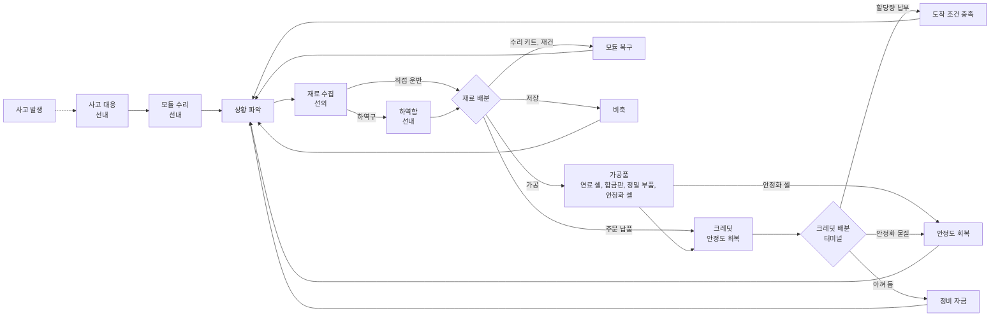
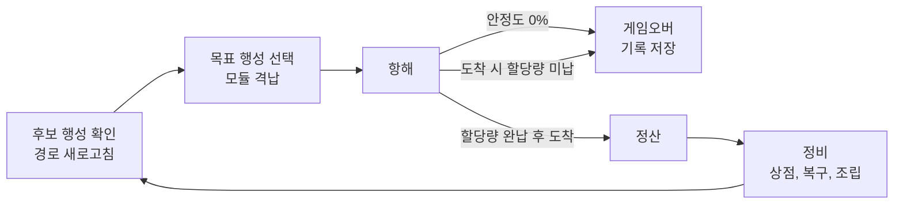

# Overfixed! 컨셉 기획서

## 1. 개요

### 1.1 한 줄 소개

행성을 고르면 정해지는 경로를 따라 우주를 가로지르며, 흘러가는 재료를 모아 선내에서 가공하고 주문을 채우며, 곳곳에서 터지는 사고를 수습해 우주선을 지켜 내는 우주 물류 아케이드.

### 1.2 게임 소개

플레이어는 행성과 행성 사이를 오가는 화물선의 신입 물류 직원입니다. 출항할 때마다 터미널에서 후보 행성 셋 중 하나를 고르면, 그 행성까지 가는 경로와 경로가 지나는 지대가 정해집니다. 행성마다 들어오는 주문과 도착한 뒤 받는 혜택이 다르고, 경로에 어떤 지대가 걸리느냐에 따라 항해 중에 벌어지는 일이 달라집니다.

우주선은 코어와 터미널, 에어락을 품은 중앙 모듈에 여러 모듈을 앞뒤좌우로 붙여 만든 구조입니다. 모듈은 저마다 선내에서 직접 다루는 장치가 있습니다. 재료를 가공하고, 주문을 협상하고, 자원을 스캔하고, 붙은 모듈을 수리합니다. 하지만 곳곳에서 사고가 나고 방치하면 부서집니다. 모듈이 부서지면 그 장치가 멈추고 코어 안정도가 떨어지므로, 플레이어는 사고를 수습하고 모듈을 고치거나 재료로 다시 세워야 합니다.

항해가 시작되면 우주선은 정해진 경로를 따라 스스로 움직입니다. 플레이어는 선외에서 흘러가는 재료를 모아 하역구로 넘기거나 직접 들고 들어오고, 선내에서 가공해 주문을 채웁니다. 번 크레딧으로 할당량을 납부하거나 코어를 안정시키고, 사고를 수습합니다. 할당량을 모두 납부한 채 목표 행성에 도착하면 정산과 정비를 거쳐 다시 출항합니다. 정비에서는 부서진 모듈을 복구하고 새 모듈을 붙여 우주선을 키웁니다.

게임은 실패할 때까지 끝없이 이어지며, 몇 번의 항해를 버텼는지가 기록이 됩니다.

| 단계 | 시간 | 하는 일 |
|---|---|---|
| 출항 준비 | 제한 없음 | 후보 행성과 경로 확인, 경로 새로고침, 목표 행성 선택, 모듈 격납 |
| 항해 | 4~6분 (항해 횟수에 따라) | 수집, 하역, 가공, 납품, 할당량 납부, 안정화, 모듈 조작, 사고 대응, 수리와 재건 |
| 도착 | 제한 없음 | 정산, 정비 (상점, 모듈 복구, 우주선 조립) |

### 1.3 기본 정보

| 항목 | 내용 |
|---|---|
| 장르 | 3D 숄더뷰 캐주얼 아케이드 (자원 관리, 멀티태스킹, 선내 가공, 경로 선택, 우주선 조립) |
| 플랫폼 | PC (키보드 + 마우스) |
| 엔진 | Unity (3D). 웹 프로토타입(three.js 단일 HTML)으로 규칙과 수치를 먼저 검증 |
| 플레이 인원 | 1인 |
| 플레이 타임 | 항해 1회 4~6분. 게임오버까지 이어지는 무한 진행 |
| 그래픽 | 캐주얼 로우폴리 톤, 유료 및 무료 에셋 활용 |
| 개발 기간 | 5주 (프로토타입 2주, 업데이트 확장 3주) |
| 개발 인원 | 1인 (클라이언트, 초급~중급 무경력 기준) |

### 1.4 레퍼런스

| 게임 | 참고 요소 |
|---|---|
| Overcooked! | 한 번에 하나씩 들고 운반하는 방식, 재료를 가공해 납품하는 흐름, 동시다발 작업의 분주함 |
| Lethal Company | 정해진 할당량을 회사에 납부해야 하는 압박, 정산 후 다시 출발하는 구조 |
| FTL: Faster Than Light | 다음 목적지를 고르는 구조, 구간마다 다른 사건, 시스템별로 부서지는 함선 |

---

## 2. 기획 의도

### 2.1 핵심 재미

| 재미 | 설명 |
|---|---|
| 설계 | 출항 전에는 행성과 경로를, 정비에서는 우주선 배치를 정한다. 어떤 지대를 감수할지, 어떤 모듈을 어느 모듈 옆에 붙일지 고른다 |
| 우선순위 판단 | 재료는 흘러가 사라지고, 주문은 마감이 다가오고, 사고는 방치할수록 커진다. 지금 무엇을 먼저 할지 계속 고른다 |
| 지킬 곳과 버릴 곳 | 사고가 동시에 터지면 모두 막을 수 없다. 지금 가장 필요한 장치를 가진 모듈부터 지킨다 |
| 크레딧 배분의 딜레마 | 같은 크레딧이 할당량 납부, 안정화 물질, 다음 정비 자금이 된다. 언제 얼마를 쓸지 고른다 |
| 재료 배분의 딜레마 | 같은 고철이 바로 납품하면 크레딧, 가공하면 비싼 가공품, 수리 키트에 넣으면 내구도, 재건에 쓰면 부서진 모듈이 된다 |
| 시간과 보상의 교환 | 터미널 즉시 납품과 납품소 포장 납품(+30%), 원재료 주문과 가공품 주문 중 무엇에 시간을 쓸지 고른다 |
| 있는 곳이 곧 선택 | 재료는 선외에, 가공과 사고와 장치는 선내에 있다. 하역구로 일부를 넘길 수 있지만, 한 곳에 있는 동안 나머지는 방치된다 |

설계는 "계획의 재미", 항해는 "계획이 틀어졌을 때 수습하는 재미"를 맡습니다. 두 재미가 한 번의 출항 안에서 이어집니다.

### 2.2 단조로움 방지 설계

| 분류 | 장치 | 효과 |
|---|---|---|
| 매 출항의 변화 | 후보 행성 종류, 경로 지대 추첨 | 같은 판이 두 번 나오지 않음 |
| 플레이어의 설계 | 행성 선택, 경로 새로고침, 직접 조립하는 우주선 | 같은 후보 앞에서도 플레이어마다 다른 항해가 됨 |
| 항해 중의 기복 | 지대 효과 | 경로가 지나는 지대에 따라 조용한 구간과 위기 구간이 생김 |
| 항해 중의 변화 | 모듈 파괴와 재건 | 어떤 모듈이 부서졌느냐에 따라 같은 항해 안에서도 할 수 있는 일이 바뀜 |
| 매 판의 변화 | 무작위 주문, 흘러가는 재료, 무작위 사고 | 필요한 재료와 동선이 매번 달라짐 |
| 선내 작업 | 가공, 포장 납품, 협상, 스캔, 수리 키트, 원격 진압 | 모듈이 늘수록 선내에서 할 수 있는 일이 늘어남 |
| 행동의 다양성 | 사고별 대응 방식, 수리와 재건, 터미널 납부와 구매 | 홀드, 도구, 미니게임, 재료 투입 등 해결 방법이 다름 |
| 성장의 변화 | 모듈 추가, 견인빔, 새로고침 강화 | 일하는 방식과 고를 수 있는 경로가 바뀜 |
| 끝없는 진행 | 항해할수록 오르는 난이도 | 기록을 갱신하려는 동기 |

### 2.3 개발 의도 (포트폴리오)

| 기술 포인트 | 적용 내용 |
|---|---|
| 행성 경로 생성 | 후보 행성마다 지대를 가중치 무작위로 중복 없이 뽑고, 항해 횟수에 따라 불리한 지대의 가중치를 올림. 새로고침은 같은 규칙으로 다시 뽑음 |
| 항해 타임라인 | 항해 시간을 일반 구간과 지대 구간으로 나누고, 구간의 시작과 끝 시각에 지대 효과를 적용하고 해제. 진입 10초 전 예고 이벤트 발행 |
| 평면 격자 기반 우주선 조립 | 2D 격자 위 모듈 배치, 중앙 모듈까지의 연결 검사, 붙어 있는 모듈 사이 문 자동 생성 |
| 인접 효과 계산 | 수리 베이, 방재실처럼 붙어 있는 모듈에만 작용하는 장치를 배치가 바뀔 때마다 다시 계산 |
| 가공 레시피 | 정제실, 조립실, 안정화실이 같은 레시피 테이블과 처리 상태(투입, 대기, 완성)를 공유. 테이블에 한 줄 추가로 레시피 확장. 가공품 주문은 해당 모듈이 있을 때만 등장 |
| 조작형 모듈 공통 구조 | 홀드 진행도, 쿨다운, 대상 선택을 공통 처리. 포장 납품, 협상, 스캔, 원격 진압이 같은 구조를 씀 |
| 사고 스케줄러 | 무작위 간격으로 사고를 배정하고, 동시 사고 상한과 단계별 악화를 관리 |
| 데이터 드리븐 설계 | 밸런스는 CSV, 인스펙터 조절값은 ScriptableObject, 기록은 JSON으로 분리 |
| 이벤트 기반 UI 갱신 | 안정도, 크레딧, 할당량 납부, 주문, 모듈 내구도, 지대 진입이 바뀌면 이벤트를 발행하고 UI가 구독 |
| 오브젝트 풀링 | 재료와 구조 캡슐을 풀에서 재사용 |
| 대응 타입 공통 구조 | 사고, 수리, 재건, 모듈 장치가 같은 대응 타입을 공유 |
| 3D 선외 이동 | 중앙 모듈 중심의 구 범위 안에서 관성이 있는 3D 제트팩 이동 |

---

## 3. 핵심 루프

### 3.1 항해 중 루프

| 단계 | 하는 일 | 고민하는 것 |
|---|---|---|
| 재료 수집 | 선외로 나가 흘러오는 재료를 잡음 | 무엇을 노릴지, 얼마나 멀리 갈지 |
| 하역 | 보조 에어락 하역구에 넣고 선외에 남거나, 직접 들고 들어옴 | 선외에 더 머물지, 지금 들어갈지 |
| 재료 배분 | 납품, 가공, 수리 키트, 재건, 저장 중 하나에 씀 | 주문 마감, 가공품 보상, 기능 복구, 다음 항해 중 무엇이 급한지 |
| 크레딧 배분 | 터미널에서 할당량을 납부하거나 안정화 물질을 사거나 아껴 둠 | 할당량을 먼저 채울지, 안정도를 살지, 정비를 위해 남길지 |
| 모듈 조작 | 포장 납품, 협상, 스캔, 원격 진압 | 쿨다운과 홀드 시간을 어디에 쓸지 |
| 사고 대응 | 화재, 산소 누출, 기기 오류를 해결 | 하던 일을 멈추고 돌아갈지 |
| 모듈 수리 | 손상된 모듈 안에서 수리 패널을 홀드 | 부서지기 전에 고칠지, 다른 일을 먼저 할지 |

### 3.2 출항 루프

출항할수록 할당량, 항해 시간, 자연 감소, 사고 빈도, 불리한 지대가 뽑힐 확률이 올라갑니다. 끝은 없고, 게임오버 때 완료한 항해 수와 누적 크레딧이 기록으로 남습니다.

### 3.3 재화

재화는 크레딧 하나입니다.

| 얻는 곳 | 쓰는 곳 |
|---|---|
| 주문 납품, 도착 보상, 조난선 구조, 모듈 철거 환불 | 할당량 납부, 안정화 물질, 상점 강화, 모듈 구매, 모듈 복구와 재건 |

고철, 연료 셀, 크리스탈 같은 재료와 합금판, 정밀 부품, 안정화 셀 같은 가공품은 재화가 아니라 손에 들고 옮기는 물건입니다. 주문에 납품해야 크레딧이 되고, 가공, 수리 키트, 재건에도 쓰입니다.

### 3.4 게임오버와 기록

| 구분 | 조건 |
|---|---|
| 게임오버 | 코어 안정도 0% (즉시), 또는 도착 시 할당량 미납 |
| 기록 | 완료한 항해 수 (주 기록), 누적 크레딧 (보조 기록, 게임 전체에서 번 크레딧의 합. 철거 환불은 제외). 최고 기록은 저장 |

---

## 4. 예시 게임 플레이 시나리오

다섯 번째 항해 한 번을 단계별로 따라갑니다. 업데이트 확장까지 적용된 상태를 기준으로 합니다.

### 4.1 시작 상태

| 항목 | 상태 |
|---|---|
| 항해 | 5번째 |
| 코어 안정도 | 60% (이전 도착 시 50% + 정비에서 산 안정화 물질 1개) |
| 보유 크레딧 | 320 |
| 우주선 | 중앙 모듈 + 모듈 5개: 보조 에어락 (앞), 납품소 (우현), 정제실 (뒤), 수리 베이 (우현 뒤, 납품소와 정제실 사이), 통신실 (좌현) |
| 업그레이드 | 운반량 I, 새로고침 I |

### 4.2 출항 준비: 목표 행성과 경로

정비를 마치고 중앙 모듈의 터미널을 열면 후보 행성 3개가 나옵니다. 이번 항해의 할당량 450, 항해 시간 5분, 도착 보상 120은 세 후보가 모두 같고, 차이는 행성 종류와 경로 지대에서 납니다.

| 후보 | 주문 경향 | 정비 혜택 | 모듈 상한 | 경로 지대 |
|---|---|---|---|---|
| 결정 행성 | 크리스탈 주문이 많고 보상 +30% | 없음 | 4 | 자원 밀집 지대, 급류 지대, 성운 |
| 공업 행성 | 재료가 고르게 섞임 | 모듈 구매 30% 할인 | 8 | 소행성대, 이온 폭풍, 잔해 지대 |
| 연구 행성 | 연료 셀 주문이 많음 | 안정화 물질 30% 할인 | 6 | 소행성대, 성운, 이온 폭풍 |

안정도가 60%라 다음 정비에서 안정화 물질을 싸게 살 수 있는 연구 행성이 끌리지만, 경로가 불리한 지대로만 채워져 있습니다. 결정 행성은 보상이 크지만 모듈 상한이 4라서, 고르면 모듈 하나를 격납해야 합니다.

플레이어는 연구 행성의 경로를 새로고침합니다. 소행성대, 정거장, 고요 지대가 새로 뽑힙니다. 소행성대는 남았지만 정거장에서 안정화 물질을 반값에 살 수 있고, 마지막 고요 지대에서 밀린 일을 정리할 수 있습니다. 새로고침이 한 번 더 남았지만 이 경로로 정하고 연구 행성을 고릅니다. 모듈이 5개라 상한 6 안에 들어가므로 격납 없이 출항합니다.

| 구간 | 시각 |
|---|---|
| 일반 | 0:00 ~ 0:30 |
| 소행성대 | 0:30 ~ 1:30 |
| 일반 | 1:30 ~ 2:00 |
| 정거장 | 2:00 ~ 3:00 |
| 일반 | 3:00 ~ 3:30 |
| 고요 지대 | 3:30 ~ 4:30 |
| 일반 | 4:30 ~ 5:00 |

### 4.3 항해 초반: 하역구와 소행성대

출항 직후 플레이어는 선외로 나갑니다. 주문에 필요한 연료 셀과 고철이 밝게 빛나고, 레이더에도 흰 테두리로 표시됩니다. 운반량 I 덕분에 두 개를 든 채로, 보조 에어락 지붕의 하역구에 넣고 다시 재료를 쫓습니다. 해치와 하역구가 모듈 양쪽 끝에 떨어져 있어서 헷갈리지 않습니다.

소행성대에 들어서자 사고 간격이 절반으로 줄어듭니다. 고철 두 개를 들고 선내로 돌아오던 중 정제실에 화재가, 납품소에 산소 누출이 거의 동시에 납니다. 마감이 10초 남은 연료 셀 주문이 걸려 있어서, 플레이어는 먼저 좌현 통신실의 협상 콘솔을 2초 홀드해 그 주문 제한시간을 20초 늘립니다. 그다음 납품소 밸브를 잠그고, 중앙 모듈 거치대에서 소화기를 들고 정제실로 달려가 불을 끕니다. 불이 2단계까지 커지는 바람에 정제실 내구도는 70%까지 떨어집니다. 플레이어는 수리 베이 키트대에 고철 1개를 넣어 정제실 내구도를 95%로 올리고, 하역함의 연료 셀로 협상해 둔 주문을 채웁니다.

그 사이 크리스탈이 필요한 주문 하나가 마감을 넘겨 실패하고, 안정도가 5% 떨어집니다.

### 4.4 소행성대 끝: 모듈 파괴와 재건

소행성대를 빠져나갈 무렵 통신실에서 기기 오류가 납니다. 플레이어는 구 경계 근처의 크리스탈을 쫓던 중이라 늦게 돌아왔고, 결국 통신실이 파괴됩니다. 안정도가 10% 떨어지고 협상 콘솔이 멈춥니다. 통신실은 수리 베이와 떨어진 좌현에 있어 수리 키트도 닿지 않는 자리였습니다.

재건에는 고철 3개와 연료 셀 1개가 필요합니다. 연구 행성 주문은 연료 셀을 자주 요구하므로 손에 든 연료 셀은 주문에 쓰고, 고철 3개를 정제실에 넣어 연료 셀을 따로 만듭니다(12초). 고철 3개를 더 모아 정거장에 들어설 즈음 재건 지점에 넣자, 통신실이 내구도 50%로 다시 세워집니다.

### 4.5 항해 중반: 정거장과 가공품 주문

정거장을 지나는 동안 안정화 물질이 반값인 30 크레딧이 됩니다. 이 시점의 보유 크레딧은 590, 안정도는 52%입니다. 두 개를 사고 싶지만 할당량 450 중 아직 하나도 납부하지 않았고, 남은 시간에 얼마를 더 벌지 확실하지 않습니다. 플레이어는 안정화 물질을 하나만 사서 안정도를 62%로 올리고, 할당량 중 300을 먼저 납부합니다. 남은 크레딧은 260입니다.

마침 합금판 주문(85 크레딧)이 뜹니다. 정제실이 있어서 나오는 가공품 주문입니다. 플레이어는 빈손으로 정제실에서 E를 눌러 레시피를 합금판으로 바꾸고, 하역함의 고철 2개를 넣어 10초 뒤 합금판을 꺼냅니다. 터미널에 바로 넣지 않고 납품소에서 2초 홀드로 포장 납품해 보상을 30% 더 받습니다.

### 4.6 항해 후반: 고요 지대와 도착

고요 지대에서는 사고가 나지 않는 대신 재료가 절반으로 줄어듭니다. 플레이어는 이 틈에 통신실 수리 패널을 잡고 내구도를 80%까지 올린 뒤, 가까운 재료로 남은 주문을 채웁니다.

마지막 일반 구간에서 연료 셀 주문 하나를 놓쳐 안정도가 다시 5% 떨어집니다. 도착 30초 전 터미널에서 남은 할당량 150을 납부해 완납합니다. 목표 행성에 도착했을 때 보유 크레딧은 400, 안정도는 65%입니다.

### 4.7 정산과 정비

| 정산 항목 | 결과 |
|---|---|
| 할당량 납부 | 450 / 450 (완납) |
| 도착 보상 | 120 |
| 주문 성공 / 실패 | 12 / 2 |
| 해결한 사고 | 8 |
| 파괴된 모듈 / 재건한 모듈 | 1 / 1 |
| 남은 안정도 | 65% |
| 완료한 항해 | 5 |

도착 보상을 받아 보유 크레딧은 520이 됩니다. 연구 행성의 혜택과 정거장 할인이 합쳐져 안정화 물질이 40% 할인된 36 크레딧이므로, 두 개를 사서 안정도를 85%로 올립니다. 손상된 통신실을 30 크레딧에 복구합니다. 화재와 기기 오류로 고생한 정제실과 통신실 사이의 좌현 뒤 칸에는 방재실을 할인가 162 크레딧에 사서 붙입니다. 방재실은 붙은 두 모듈의 사고 악화를 늦추고, 원격 진압 콘솔로 정제실 화재를 소화기 없이 끌 수 있게 해 줍니다. 다음 출항은 모듈 6개, 안정도 85%, 크레딧 256으로 시작합니다. 모듈이 6개이므로 다음 후보 중 결정 행성이나 교역 행성을 고르면 격납이 필요합니다.

### 4.8 이 항해에서 나온 선택들

| 선택 | 얻은 것 | 잃은 것 |
|---|---|---|
| 연구 행성 선택 | 정비에서 싼 안정화 물질 | 결정 행성의 높은 주문 보상 |
| 연구 행성 경로 새로고침 | 정거장과 고요 지대 | 새로고침 기회 1회 |
| 하역구에 재료를 넘기고 선외에 남음 | 선외 체류 시간 | 사고 대응까지의 이동 거리 |
| 화재보다 협상과 마감 임박 주문을 먼저 처리 | 주문 성공 | 정제실 화재 악화 (내구도 70%) |
| 고철 1개를 수리 키트에 사용 | 정제실 내구도 +25 | 고철 주문 몫 |
| 통신실 사고보다 크리스탈 추적을 우선 | 크리스탈 확보 | 통신실 파괴, 안정도 10% 손실 |
| 정제실로 연료 셀을 만들어 재건 | 연료 셀 주문 몫 유지, 통신실 복귀 | 고철 3개와 변환 시간 |
| 정거장에서 안정화 물질 1개만 사고 300 먼저 납부 | 할당량 미납 위험 감소 | 반값 기회 일부 |
| 합금판을 포장 납품 | 보상 +30% | 2초 홀드와 납품소까지의 이동 |
| 정비에서 방재실 구매 | 정제실과 통신실의 사고 악화 완화, 원격 진압 | 다음 정비를 위한 크레딧 |

---

## 5. 게임 시스템

(확장) 표시는 업데이트 확장 기간에 추가하는 내용입니다(7.1 참고). 표시가 없으면 프로토타입 범위입니다.

### 5.1 플레이어 조작

| 입력 | 선내 | 선외 | 터미널 화면 | 조립 화면 (확장) |
|---|---|---|---|---|
| WASD | 이동 | 제트팩 수평 이동 (관성 있음) | - | - |
| Space | 미니게임 입력 | 상승 | - | - |
| Ctrl 또는 C | - | 하강 | - | - |
| 마우스 | 카메라 회전 | 카메라 회전 | 커서 이동 | 커서 이동 |
| E | 줍기, 투입, 납품, 터미널 열기, 레시피 전환 | 줍기, 하역구에 넣기, 에어락 진입 | - | - |
| E 홀드 | 홀드형, 도구 홀드형 대응 (사고, 수리, 모듈 장치) | - | - | - |
| Q | 내려놓기 | 놓기 (다시 흘러감) | - | - |
| 좌클릭 | - | - | 선택 | 모듈 배치, 이동 |
| 우클릭 | - | 견인빔 (홀드, 해금 후) | - | 모듈 격납 |
| 휠 | - | - | - | 시점 확대, 축소 |
| Esc | 일시정지 | 일시정지 | 터미널 닫기 | 조립 화면 닫기 |

- 기본 시점은 오른쪽 어깨 뒤에서 보는 숄더뷰입니다. 선내에서는 지붕을 숨기고, 카메라를 가리는 벽은 투명하게 처리합니다.
- 터미널 앞에서 재료를 들고 E를 누르면 납품하고, 빈손으로 누르면 터미널 화면이 열립니다.
- 터미널 화면은 중앙 모듈에서 여는 2D 화면이고, 조립 화면은 정비에서 여는 3D 우주선 편집 화면입니다.
- 브라우저에서 Ctrl+W가 탭을 닫을 수 있어 하강은 C로도 할 수 있게 했습니다. 항해 중에는 페이지를 떠나기 전에 확인 창을 띄웁니다.
- F9는 개발용 디버그 패널(배속, 크레딧 지급, 사고 발생, 지대 건너뛰기)입니다.

### 5.2 우주선과 모듈

> 우주선은 중앙 모듈을 중심으로 평면 격자 위에 모듈을 붙여 만든다. 모듈마다 선내에서 다루는 장치가 있고, 부서지면 그 장치가 멈춘다.

**구조**
- 중앙 모듈은 격자의 중심에 고정되어 있고, 옮기거나 철거할 수 없습니다.
- 격자는 중앙 모듈을 중심으로 한 5×5 평면이고, 한 칸은 10m입니다.
- 모듈은 격자 한 칸을 차지하며, 앞뒤좌우 4방향으로만 붙일 수 있습니다. 위아래로는 붙일 수 없습니다. 모든 모듈은 면으로 이어져 중앙 모듈까지 연결되어야 합니다.
- 붙어 있는 모듈 사이에는 자동문이 생깁니다. 선내는 단층입니다.
- 같은 종류의 모듈을 여러 개 붙일 수 있습니다.
- 한 번의 항해에 붙이고 갈 수 있는 모듈 수는 목표 행성 종류의 모듈 상한을 따릅니다 (5.10 참고). 붙이지 않은 모듈은 격납고에 보관합니다.

**중앙 모듈**

| 구성 | 역할 |
|---|---|
| 코어 | 코어 안정도를 가짐. 0%가 되면 게임오버. 안정화 셀을 넣는 곳 |
| 터미널 | 함선의 모든 시스템을 관리 (5.7 참고) |
| 에어락 | 선외 출입. 감압 1초 |
| 소화기 거치대 | 화재 대응용 소화기 보관 |

- 중앙 모듈에는 내구도가 없어 파괴되지 않고, 사고도 나지 않습니다.

**시작 배치**

| 위치 | 모듈 |
|---|---|
| 중심 | 중앙 모듈 |
| 중앙 모듈 앞 | 보조 에어락 |
| 중앙 모듈 우현 | 납품소 |

**모듈 목록**

모듈은 선내에서 하는 일에 따라 세 갈래로 나뉩니다.

| 분류 | 의미 |
|---|---|
| 조작형 | 장치를 E 또는 E 홀드로 직접 다룸. 쿨다운이 있는 것도 있음 |
| 가공형 | 재료를 넣으면 시간이 지나 가공품이 나옴 (5.5 레시피 참고) |
| 자동형 | 붙여 두기만 해도 돌아감 |

| 모듈 | 분류 | 가격 | 선내 장치와 효과 | 여러 개일 때 |
|---|---|---|---|---|
| 보조 에어락 | 조작형 | 150 | 선외 출입구 추가. 지붕 하역구에 넣은 재료가 선내 하역함(6칸)으로 들어감. 해치와 하역구는 모듈 양 끝에 떨어져 있음 | 출입구와 하역함이 늘어남 |
| 납품소 | 조작형 | 180 | 포장 납품대. 재료를 들고 E 2초 홀드로 납품하면 그 주문 보상 +30% | 납품 지점이 늘어남 |
| 정제실 | 가공형 | 200 | 고철 3 → 연료 셀 (12초), 고철 2 → 합금판 (10초). 빈손으로 E를 누르면 레시피 전환 | 여러 곳에서 동시에 가공 |
| 수리 베이 | 조작형 | 220 | 수리 키트대. 고철 1개를 넣으면 붙은 모듈 중 가장 손상된 곳 내구도 +25 | 키트대가 늘어남 |
| 드론 베이 | 자동형 | 220 | 12초마다 드론이 반경 25m 안의 재료 1개를 주워 거치대(3칸)에 둠. 거치대가 차면 멈춤 | 드론이 늘어남 |
| 통신실 (확장) | 조작형 | 200 | 협상 콘솔. E 2초 홀드로 가장 급한 주문 제한시간 +20초. 주문당 1회, 쿨다운 20초 | 콘솔마다 쿨다운이 따로 돎 |
| 저장고 (확장) | 조작형 | 150 | 재료 4칸 보관. 보관한 재료는 다음 항해로 이월 | 보관 칸이 늘어남 |
| 방재실 (확장) | 조작형 | 180 | 붙은 모듈의 사고 악화 간격 10초 → 20초. 원격 진압 콘솔로 붙은 모듈의 화재, 산소 누출을 E 5초 홀드로 해결 (소화기 불필요) | 악화 지연은 중첩되지 않음 |
| 관측실 (확장) | 조작형 | 200 | 스캐너. E 3초 홀드로 구 경계에 크리스탈 3개를 띄우고 레이더에 표시 (쿨다운 45초). 사고 발생 10초 전 예고 | 스캐너마다 쿨다운이 따로 돎 |
| 안정화실 (확장) | 가공형 | 250 | 합성기. 연료 셀 1 + 크리스탈 1 → 안정화 셀 (20초). 안정화 셀을 코어에 넣으면 안정도 +12% | 여러 곳에서 동시에 합성 |
| 조립실 (확장) | 가공형 | 240 | 조립대. 합금판 1 + 크리스탈 1 → 정밀 부품 (15초) | 여러 곳에서 동시에 조립 |

- 모든 모듈은 내구도 100을 가집니다. 파괴된 모듈도 지나다닐 수 있고, 장치만 멈춥니다.
- 각 모듈에는 수리 패널과 재건 지점이 하나씩 있습니다.
- 선외 활동 반경은 중앙 모듈에서 가장 먼 모듈까지의 거리에 20m를 더한 구입니다. 우주선이 커지면 반경도 함께 넓어집니다.
- 모듈을 늘릴수록 선내에서 할 수 있는 일은 늘지만, 지켜야 할 곳과 이동 거리도 함께 늘어납니다. 사고 발생 간격은 모듈 수와 무관합니다.

### 5.3 모듈 손상, 수리, 재건

> 모듈은 내구도가 있다. 사고로 손상되면 고치고, 부서지면 재료로 다시 세운다.

| 상태 | 원인 | 해결 방법 | 대응 타입 |
|---|---|---|---|
| 손상 | 처리하지 못한 사고 | 손이 빈 상태로 모듈 안 수리 패널을 E 홀드. 누르는 동안 초당 내구도 6 회복 (수리속도 강화 시 1.5배, 2배). 또는 붙은 수리 베이 키트대에 고철 1개 (+25) | 홀드형, 재료 투입형 |
| 파괴 | 내구도 0 | 재건 지점에 고철 3개와 연료 셀 1개를 넣으면 내구도 50%로 다시 세워짐 | 재료 투입형 |

- 모듈이 파괴되는 순간 코어 안정도가 10% 줄어듭니다.
- 수리는 내구도만 회복하며, 코어 안정도는 오르지 않습니다.
- 파괴되면 그 모듈의 가공 중이던 재료와 진행 중인 사고는 사라집니다.
- 도착 후 정비에서 크레딧으로 손상된 모듈을 복구하고 파괴된 모듈을 다시 세울 수 있습니다.
- 손상과 파괴 상태는 복구하지 않으면 다음 항해로 이어집니다.

### 5.4 선외 활동

> 중앙 모듈을 중심으로 한 구(球) 안에서 자유롭게 움직인다.

- 중앙 모듈이나 보조 에어락의 에어락으로 나가면 지붕 위로 나와 활동 반경 안을 3D로 날아다닙니다. 우주선은 평면이지만 선외 이동은 상하좌우 모든 방향으로 할 수 있습니다.
- 제트팩은 관성이 있습니다. 최고 속도 12m/s, 가속 26m/s², 감속 계수 1.8입니다.
- 경계에서 6m 안으로 들어오면 화면 가장자리에 경고가 뜨고, 경계에 닿으면 안쪽으로 부드럽게 밀려납니다. 선체 안으로는 들어갈 수 없습니다.
- 재료는 우주선 앞쪽에서 생겨나 여러 높이로 뒤쪽을 향해 흘러가고, 구 밖으로 나가면 사라집니다.
- 지붕의 에어락 해치에서 E를 누르면 선내로 들어갑니다(가압 1초). 보조 에어락의 하역구에서 E를 누르면 손에 든 재료가 모두 선내 하역함으로 들어갑니다. 구조 캡슐은 하역구에 넣는 즉시 보상으로 바뀝니다.
- 가공, 사고 대응, 수리, 납품, 터미널 사용은 모두 선내에서만 할 수 있습니다.

### 5.5 재료와 가공

> 재료는 우주선 옆을 흘러 지나가고, 놓치면 사라진다. 선내에서 가공하면 더 비싼 주문을 채울 수 있다.

**수집**
- 재료는 초당 1.5개꼴로 생겨 2.5m/s로 흐릅니다. 줍기 범위는 4.5m입니다.
- 고철과 연료 셀은 선체 가까이 몰려 흐르고, 선체에서 1.2m 안으로는 생기지 않습니다. 크리스탈은 구 경계 근처(반경의 80% 이상)에서만 나옵니다.
- 흐르는 재료마다 재료 색의 빛무리가 있습니다. 지금 주문에 필요한 재료와 그 재료를 만드는 데 드는 재료는 크게 깜빡입니다.
- 한 번에 1개만 들 수 있습니다. 운반량 I 강화를 하면 2개까지 들 수 있고, 서로 다른 재료를 함께 들 수 있으며, 넣을 때는 나중에 주운 것부터 들어갑니다.
- 무거운 재료를 들면 느려집니다 (가장 무거운 재료의 이동 배율을 따름).
- 선외에서 놓은 재료는 다시 흘러갑니다. 선내에 내려놓은 재료는 그 자리에 남지만, 도착하면 저장고에 넣은 재료를 빼고 모두 사라집니다. 하역함, 드론 거치대, 가공 중인 재료도 도착하면 사라집니다.
- 견인빔 강화를 하면 우클릭 홀드로 조준한 재료 1개를 15m 안에서 끌어올 수 있습니다. 손이 가득 차 있으면 쓸 수 없습니다.

**재료**

| 재료 | 특징 | 이동 배율 | 쓰임 |
|---|---|---|---|
| 고철 | 가장 흔함 | 1.0 | 납품, 정제, 수리 키트, 재건 (3개) |
| 연료 셀 | 무거움. 정제로도 만듦 | 0.75 | 납품, 합성, 재건 (1개) |
| 크리스탈 | 구 경계 근처에서만 나옴, 주문 보상이 높음 | 1.0 | 납품, 조립, 합성 |
| 구조 캡슐 (확장) | 조난선 지대에서만 나옴, 무거움 | 0.6 | 에어락이나 하역구에 넣으면 60 크레딧 |

**가공품**

| 가공품 | 만드는 곳 | 재료 | 시간 | 쓰임 |
|---|---|---|---|---|
| 연료 셀 | 정제실 | 고철 3 | 12초 | 납품, 합성, 재건 |
| 합금판 | 정제실 | 고철 2 | 10초 | 가공품 주문, 조립 |
| 정밀 부품 (확장) | 조립실 | 합금판 1 + 크리스탈 1 | 15초 | 가공품 주문 |
| 안정화 셀 (확장) | 안정화실 | 연료 셀 1 + 크리스탈 1 | 20초 | 코어에 넣으면 안정도 +12% |

- 가공 장치는 필요한 재료가 모두 들어가야 시작합니다. 재료는 한 개씩 넣고, 다른 레시피 재료는 받지 않습니다.
- 다 된 가공품을 꺼내야 다음 가공을 시작할 수 있습니다.
- 레시피가 여러 개인 장치는 비어 있을 때만 빈손 E로 레시피를 바꿀 수 있습니다.

### 5.6 코어 안정도

> 0%가 되면 즉시 게임오버. 시간, 주문 실패, 모듈 파괴가 깎고, 주문 성공, 안정화 물질, 안정화 셀이 채운다.

| 구분 | 원인 | 변화 |
|---|---|---|
| 하락 | 시간 경과 | 초당 0.02~0.04% (항해 횟수에 따라 증가) |
| 하락 | 주문 실패 (제한시간 초과) | 5% |
| 하락 | 모듈 파괴 | 10% |
| 회복 | 주문 성공 | 2% |
| 회복 | 안정화 물질 | 10% |
| 회복 | 안정화 셀 (확장) | 12% |

- 안정도를 회복하는 방법은 주문 성공, 안정화 물질, 안정화 셀 세 가지뿐입니다.
- 안정화 물질은 터미널에서 크레딧으로 사며, 사는 즉시 적용됩니다. 항해 중과 정비에서 모두 살 수 있습니다.
- 안정화 셀은 크레딧 대신 재료와 시간으로 안정도를 사는 방법입니다.
- 사고는 안정도를 직접 깎지 않습니다. 사고를 방치해 모듈이 파괴될 때 안정도가 줄어듭니다.
- 안정도는 최대 100%이고, 도착했을 때의 안정도가 다음 항해로 그대로 이어집니다. 자동 회복은 없습니다.
- 30% 이하가 되면 화면 테두리가 붉게 맥동하고 경고음이 울립니다.

### 5.7 터미널

> 중앙 모듈의 터미널이 함선의 모든 시스템을 관리한다.

- 중앙 모듈 안에 있고, 빈손으로 E를 눌러 엽니다. 터미널을 여는 동안에도 항해는 계속되므로, 오래 머무를수록 다른 일이 밀립니다.
- 터미널은 파괴되지 않습니다.

| 기능 | 내용 | 쓰는 때 |
|---|---|---|
| 주문 보드 | 현재 주문, 필요한 재료, 남은 시간 표시 | 항해 |
| 납품 | 재료를 들고 E. 그 재료가 필요한 주문 중 마감이 가장 급한 주문에 들어감 | 항해 |
| 할당량 납부 | 원하는 만큼 크레딧을 나눠서 납부 (-50, -10, +10, +50, 최대). 납부한 크레딧은 돌려받지 못함 | 항해 |
| 안정화 물질 구매 | 크레딧으로 사면 즉시 안정도 회복 | 항해, 정비 |
| 모듈 상태 | 모듈별 위치, 내구도, 진행 중인 사고와 단계, 재건 진행도 | 항해 |
| 행성 선택 | 후보 행성, 경로 지대, 새로고침, 격납 | 출항 준비 |

### 5.8 주문, 납품, 할당량

> 주문을 채워 크레딧을 벌고, 그 크레딧으로 도착 전까지 할당량을 납부해야 한다.

**주문**
- 주문은 필요한 재료 1~2종, 제한시간, 보상으로 구성됩니다. 동시에 3개까지 뜹니다.
- 목표 행성 종류에 따라 특정 재료가 들어간 주문이 자주 나오고, 보상과 제한시간이 달라집니다 (5.10 참고).
- 가공품 주문은 그 가공품을 만드는 모듈이 우주선에 붙어 있고 부서지지 않았을 때만 나옵니다. 합금판 주문은 정제실, 정밀 부품 주문은 정제실과 조립실이 있어야 합니다.
- 중앙 모듈의 터미널에 재료를 넣으면, 그 재료가 필요한 주문 중 마감이 가장 급한 주문에 자동으로 들어갑니다. 어느 주문에도 맞지 않는 재료는 받지 않습니다.
- 납품소에서는 E 2초 홀드로 포장 납품합니다. 포장 납품한 재료가 들어간 주문은 완료할 때 보상이 30% 늘어납니다. 홀드를 중간에 멈춰도 진행도는 남습니다.
- 2종짜리 주문은 재료별로 채워지고, 모두 채우면 완료됩니다. 완료하면 보상 크레딧을 받고 코어 안정도가 2% 오릅니다.
- 제한시간이 지나면 주문은 실패하고 코어 안정도가 5% 떨어집니다. 이미 넣은 재료는 돌려받지 못합니다. 빈자리는 5초 뒤 새 주문으로 채워집니다.
- 통신실 협상으로 가장 급한 주문의 제한시간을 20초 늘릴 수 있습니다 (주문당 1회).

**할당량**
- 할당량은 항해 횟수로 정해지고, 출항 준비에서 미리 표시됩니다. 같은 항해의 후보 행성은 할당량이 모두 같습니다.
- 할당량은 터미널에서 크레딧으로 납부합니다. 항해 중 언제든 나눠서 낼 수 있고, 다 내면 더 낼 수 없습니다.
- 도착할 때까지 다 내지 못하면 게임오버입니다.
- 같은 크레딧이 할당량 납부, 안정화 물질, 정비 자금으로 갈리므로 언제 얼마를 낼지가 선택이 됩니다.

### 5.9 사고

> 중앙 모듈을 뺀 모듈 곳곳에서 사고가 나고, 처리하지 못하면 그 모듈의 내구도가 줄어든다.

- 일정 간격마다 무작위로 고른 모듈에서 무작위 종류의 사고가 납니다. 항해 횟수가 늘수록 자주 나고, 소행성대를 지나는 동안에는 간격이 절반으로 줄어듭니다.
- 동시에 진행되는 사고는 최대 3개입니다. 파괴된 모듈에서는 사고가 나지 않고, 사고가 진행 중인 모듈이 파괴되면 그 사고는 사라집니다.
- 진행 중인 동안 해당 모듈의 내구도가 초당 1씩 줄고, 10초마다 피해가 1.5배로 커집니다 (최대 3단계, 초당 2.25). 내구도가 0이 되면 모듈이 파괴됩니다.
- 사고가 진행 중인 모듈은 수리 패널이 잠깁니다. 사고를 먼저 해결해야 수리할 수 있습니다.
- 관측실이 있으면 사고 10초 전에 어느 모듈에 무슨 사고가 날지 예고합니다.

| 사고 | 대응 방법 | 대응 타입 |
|---|---|---|
| 화재 | 중앙 모듈 거치대의 소화기를 들고 가서 E 3초 홀드 (소화기를 들면 재료를 못 듦). 붙은 방재실이 있으면 원격 진압 콘솔 E 5초 홀드로도 해결 | 도구 홀드형, 홀드형 |
| 산소 누출 | 밸브 E 4초 홀드. 붙은 방재실이 있으면 원격 진압으로도 해결 | 홀드형 |
| 기기 오류 | 콘솔에서 E로 시작, 타이밍 게임 3회 성공 (실패해도 성공 횟수는 남음) | 미니게임형 |

- 내려놓은 소화기는 10초 뒤 거치대로 돌아갑니다.
- 홀드 진행도는 손을 떼도 남아서, 다시 홀드하면 이어서 진행됩니다.

사고, 수리, 재건, 모듈 장치는 네 가지 대응 타입으로 통일합니다. 같은 타입을 쓰는 대상은 테이블에 한 줄을 추가해 늘립니다.

| 대응 타입 | 방법 | 사용처 |
|---|---|---|
| 홀드형 | E를 일정 시간 누름 | 산소 누출, 모듈 수리, 포장 납품, 협상, 스캔, 원격 진압 |
| 도구 홀드형 | 도구를 든 채 E를 일정 시간 누름 | 화재 |
| 미니게임형 | 움직이는 커서를 성공 구간에서 Space로 멈춤 | 기기 오류 |
| 재료 투입형 | 필요한 재료를 정해진 개수만큼 넣음 | 모듈 재건, 가공, 수리 키트 |

### 5.10 행성과 경로

> 출항마다 후보 행성 중 하나를 고르면 경로가 자동으로 정해진다. 행성 종류가 주문과 정비를, 경로 지대가 항해 중의 사건을 정한다.

**목표 행성 선택**
- 정비를 마치고 터미널을 열면 후보 행성 3개가 나옵니다. 같은 종류는 겹치지 않습니다.
- 행성끼리의 차이는 종류로만 정해집니다. 할당량, 항해 시간, 도착 보상, 지대 수는 항해 횟수로 정해지며 후보끼리 같습니다.
- 행성을 고르면 그 행성까지의 경로가 자동으로 정해지고, 출항 후에는 바꿀 수 없습니다.

| 종류 | 주문 경향 | 도착 후 정비 혜택 | 모듈 상한 |
|---|---|---|---|
| 광산 행성 | 고철이 들어간 주문이 자주 나옴 | 모듈 복구와 재건 비용 30% 할인 | 6 |
| 결정 행성 | 크리스탈이 들어간 주문이 자주 나오고, 주문 보상 +30% | 없음 | 4 |
| 공업 행성 | 재료가 고르게 섞임 | 모듈 구매 30% 할인 | 8 |
| 연구 행성 | 연료 셀이 들어간 주문이 자주 나옴 | 안정화 물질 30% 할인 | 6 |
| 교역 행성 | 주문 보상 +20%, 제한시간 20% 단축 | 모듈 철거 환불 50% → 80% | 5 |

- 정비 혜택은 그 행성에 도착한 뒤 하는 정비에 적용됩니다.

**경로 지대**
- 후보 행성마다 지대 10종 중 3개가 무작위로 뽑혀 경로가 됩니다. 한 경로에 같은 지대는 한 번만 나옵니다.
- 항해 횟수가 늘수록 불리한 지대가 뽑힐 확률이 올라갑니다.
- 경로는 일반 구간과 지대 구간이 번갈아 이어집니다 (일반, 지대 1, 일반, 지대 2, 일반, 지대 3, 일반). 지대 구간은 항해 시간의 20%씩, 일반 구간은 10%씩입니다.
- 지대에 들어가기 10초 전에 화면 상단에 예고가 뜹니다.

| 지대 | 효과 | 성격 | 첫 등장 |
|---|---|---|---|
| 자원 밀집 지대 | 재료가 두 배로 흘러오고 크리스탈이 1.5배 더 나옴 | 유리 | 1번째 |
| 잔해 지대 | 고철이 두 배로 흘러옴 | 유리 | 1번째 |
| 조난선 (확장) | 선외에 구조 캡슐이 나타남. 에어락이나 하역구에 넣으면 60 크레딧 | 유리 | 1번째 |
| 정거장 (확장) | 지나는 동안 안정화 물질 반값, 다음 정비의 상점 가격 10% 할인 | 유리 | 1번째 |
| 고요 지대 | 사고가 나지 않지만 재료가 절반으로 줄어듦 | 혼합 | 1번째 |
| 무역 항로 (확장) | 이 구간에 생긴 주문은 보상 1.5배, 제한시간 30% 단축 | 혼합 | 1번째 |
| 소행성대 | 사고 발생 간격이 절반으로 줄어듦 | 불리 | 1번째 |
| 이온 폭풍 (확장) | 기기 오류가 3배 자주 나고, 미니게임 성공 구간이 55%로 좁아짐 | 불리 | 2번째 |
| 성운 (확장) | 선외 시야가 좁아지고, 레이더에서 재료 표시가 사라짐 | 불리 | 2번째 |
| 급류 지대 | 재료가 1.5배 빠르게 흘러감 | 불리 | 1번째 |

- 여러 할인이 겹치면 할인율을 더해서 적용합니다.

**새로고침**
- 후보 행성 하나의 경로 지대 3개를 다시 뽑습니다. 행성 종류는 바뀌지 않습니다.
- 출항 준비마다 기본 1회 쓸 수 있고, 새로고침 강화 (확장) 1단계마다 1회씩 늘어 최대 3회까지 됩니다.

**모듈 상한과 격납 (확장)**
- 이번 항해에 붙이고 갈 수 있는 모듈 수는 목표 행성 종류의 모듈 상한을 따릅니다. 중앙 모듈은 세지 않습니다.
- 붙어 있는 모듈이 상한보다 많으면, 행성을 고른 직후 격납할 모듈을 고릅니다. 빼면 다른 모듈의 연결이 끊기는 모듈은 고를 수 없습니다.
- 격납한 모듈은 격납고에 보관되고, 다음 정비의 조립 화면에서 다시 붙일 수 있습니다.
- 프로토타입에서는 모듈 상한을 적용하지 않습니다.

### 5.11 정산과 정비

- 도착하면 할당량 완납 여부를 확인합니다. 다 내지 못했다면 게임오버이고, 다 냈다면 정산 화면으로 넘어갑니다.
- 정산 화면에서는 할당량 납부, 도착 보상, 주문 성공과 실패 수, 해결한 사고, 파괴되고 재건된 모듈 수, 구조 캡슐 수, 남은 안정도, 완료한 항해 수를 보여 줍니다.
- 정산이 끝나면 도착 보상을 받고 정비 화면으로 넘어갑니다. 정비에는 도착한 행성 종류의 혜택이 적용됩니다.
- 정비에서는 상점, 복구, 조립을 이용합니다. 준비가 끝나면 다음 목표 행성 선택으로 넘어갑니다.

| 메뉴 | 항목 |
|---|---|
| 상점: 캐릭터 | 이동속도 I·II, 운반량 I, 수리속도 I·II, 견인빔 |
| 상점: 함선 | 안정화 물질, 새로고침 I·II (확장) |
| 상점: 모듈 | 5.2 모듈 목록의 11종. 구매한 모듈은 격납고로 들어가고 조립 화면에서 배치 |
| 복구 | 손상된 모듈 수리 (잃은 내구도 10%당 15 크레딧, 100%로), 파괴된 모듈 재건 (구매가의 50%, 내구도 100%로). 격납고 모듈도 복구 가능 |
| 조립 (확장) | 격자에 배치, 모듈 이동, 격납, 철거 (구매가의 50% 환불) |

**상점 강화**

| 강화 | 가격 | 효과 | 선행 |
|---|---|---|---|
| 이동속도 I | 120 | 이동, 제트팩 속도 +15% | - |
| 이동속도 II | 220 | 이동, 제트팩 속도 +30% | 이동속도 I |
| 운반량 I | 250 | 재료를 2개까지 운반 | - |
| 수리속도 I | 100 | 수리 패널 속도 1.5배 | - |
| 수리속도 II | 180 | 수리 패널 속도 2배 | 수리속도 I |
| 견인빔 | 300 | 우클릭 홀드로 15m 안의 재료 끌어오기 | - |
| 새로고침 I (확장) | 150 | 경로 새로고침 +1회 | - |
| 새로고침 II (확장) | 250 | 경로 새로고침 +1회 (최대 3회) | 새로고침 I |

조립 화면이 들어오기 전(프로토타입)에는 시작 배치로 고정하고, 산 모듈은 정해진 빈자리에 자동으로 붙습니다.

### 5.12 난이도 상승

| 항해 | 할당량 | 항해 시간 | 자연 감소 | 사고 빈도 | 불리한 지대 비율 |
|---|---|---|---|---|---|
| 1~3번째 | 낮음 | 4분대 | 낮음 | 낮음 | 적음 |
| 4~6번째 | 중간 | 5분 안팎 | 중간 | 중간 | 중간 |
| 7~9번째 | 높음 | 5분 30초 안팎 | 높음 | 높음 | 많음 |
| 10번째 이후 | 항해마다 계속 상승 | 6분 | 상승 | 상승 | 많음 |

### 5.13 UI

| 화면 | 주요 표시 |
|---|---|
| 항해 | 코어 안정도, 우주선 모듈 상태 (5×5 미니맵, 모듈별 내구도, 사고 중인 모듈 깜빡임, 파괴된 모듈 X 표시, 선내 플레이어 위치), 남은 항해 시간, 할당량 납부 현황, 보유 크레딧, 주문 목록 (마감 15초 전 붉게), 경로 진행 막대 (지대 아이콘과 이름), 3D 레이더, 사고와 지대 예고 알림, 상호작용 안내와 홀드 진행 막대, 손에 든 물건 |
| 선외 | 위 정보에 더해 활동 반경 경계 경고, 재료 빛무리 (필요한 재료는 크게 깜빡임) |
| 터미널 | 주문 보드, 할당량 납부, 안정화 물질 구매, 모듈 상태. 출항 준비에서는 후보 행성 카드 (종류, 주문 경향, 정비 혜택, 모듈 상한, 경로 지대와 미니 경로 막대), 새로고침 남은 횟수, 격납 선택 |
| 조립 (확장) | 3D로 보는 평면 격자 위 우주선, 배치 가능한 칸 초록 표시, 연결되지 않는 칸 붉은 경고, 인접 효과 범위 파란 표시, 격납고 목록 |
| 기타 | 타이틀 (최고 기록), 정산, 정비, 게임오버 (이번 기록과 최고 기록), 일시정지, 옵션 (음량, 마우스 감도, 상하 반전, 튜토리얼), 조작법 |

- 레이더는 재료를 종류별 색으로 보여 줍니다. 위아래 높이 차이는 삼각형 방향으로, 크리스탈은 마름모로, 주문에 필요한 재료는 흰 테두리로, 관측실 스캔으로 나온 크리스탈은 청록 테두리로 표시합니다.
- 레이더와 지대 예고는 중앙 모듈이 맡으므로 꺼지지 않습니다. 성운 지대에서는 레이더의 재료 표시만 사라집니다.
- 첫 항해에는 튜토리얼 체크리스트(터미널, 선외 나가기, 줍기, 복귀, 납품, 할당량, 사고 대응)가 뜨고, 사고 종류와 모듈 파괴를 처음 겪을 때 대응 방법 안내가 한 번씩 뜹니다.

---

## 6. 데이터 테이블

### 6.1 구성 원칙

| 형식 | 용도 |
|---|---|
| CSV | 행이 여러 개인 밸런스 데이터. 스프레드시트로 편집 |
| ScriptableObject | 인스펙터에서 바로 조절하는 설정값 |
| JSON | 게임을 꺼도 남는 기록, 옵션 |

### 6.2 데이터 목록

| 데이터 | 형식 | 핵심 필드 | 용도 |
|---|---|---|---|
| VoyageTable | CSV | VoyageIndex, QuotaBase, VoyageTime, ArrivalReward, BaseDecay, EventIntervalMin, EventIntervalMax, BadZoneWeight | 항해 횟수별 난이도 |
| PlanetTypeTable | CSV | PlanetTypeID, OrderItemWeights, OrderRewardRate, OrderTimeRate, ModuleCap, MaintenanceEffectType, MaintenanceEffectValue | 행성 종류 |
| ZoneTable | CSV | ZoneID, Category, EffectType, EffectValue, SpawnWeight, MinVoyage | 경로 지대 |
| ModuleTable | CSV | ModuleID, MaxDurability, Price, EffectType, EffectValue, EffectScope | 모듈 종류 |
| ItemTable | CSV | ItemID, CarrySpeedRate, SpawnWeight, SpawnDistanceMin | 재료와 가공품 |
| OrderTable | CSV | OrderID, RequireItems, TimeLimit, Reward, RequireModule | 주문 |
| RecipeTable | CSV | RecipeID, ModuleID, InputItems, OutputItem, ProcessTime | 가공 레시피 |
| EventTable | CSV | EventID, InteractionType, InteractionValue, DurabilityDrain, SpawnWeight, Tool | 사고 |
| UpgradeTable | CSV | UpgradeID, Category, Cost, EffectType, EffectValue, Require | 정비 상점 |
| RouteConfig | ScriptableObject | CandidateCount, ZoneCount, ZoneSegmentRate, NormalSegmentRate, ZoneWarningTime, BaseRefreshCount, MaxRefreshCount, MaxVoyageTime | 후보 행성, 경로 생성 |
| ShipConfig | ScriptableObject | StartModules, GridSize, CellSize, RebuildItems, RebuildDurabilityRate, RepairPrice, RebuildPriceRate, RemoveRefundRate, ActivityMargin, AirlockTime, RepairHoldRate, DroneRange, DroneRackSize, HullClearance, ExtinguisherReturnTime | 우주선 구조, 파괴와 재건 |
| PlayerConfig | ScriptableObject | MoveSpeed, JetpackSpeed, JetpackAccel, JetpackDrag, CarryCount, TractorRange, InteractRange, ExteriorPickRange | 플레이어 |
| CoreConfig | ScriptableObject | StartStability, OrderSuccessRecovery, OrderFailPenalty, ModuleDestroyPenalty, StabilizerPrice, StabilizerRecovery, StabCellRecovery, WarningThreshold | 코어 |
| OrderConfig | ScriptableObject | MaxOrderCount, RefillDelay | 주문 |
| EventConfig | ScriptableObject | MaxEventCount, EscalateInterval, EscalateRate, MaxEscalateStep, ForecastTime, MinigameZone, MinigameSpeed | 사고 |
| SpawnConfig | ScriptableObject | BaseSpawnRate, FlowSpeed, CapsuleSpawnRate, CapsuleReward, NearBias | 재료 생성과 흐름 |
| ModuleActionConfig | ScriptableObject | PackHoldTime, ScanHoldTime, ScanCrystalCount, NegotiateHoldTime, NegotiateCooldown, RemoteHoldTime | 조작형 모듈 |
| RecordSave | JSON | BestVoyageCount, BestTotalCredit | 최고 기록 |
| OptionSave | JSON | Volume, Sensitivity, InvertY, Tutorial | 옵션 |

- 할당량, 항해 시간, 도착 보상은 VoyageTable에서 정하며 행성 종류와 무관합니다.
- 지대 구간 길이는 VoyageTime에 RouteConfig의 ZoneSegmentRate를, 일반 구간 길이는 NormalSegmentRate를 곱해 정합니다.
- 지대는 ZoneTable의 SpawnWeight로 뽑고, Category가 불리인 지대에는 VoyageTable의 BadZoneWeight를 곱합니다. MinVoyage보다 앞선 항해에서는 뽑지 않습니다.
- 주문은 OrderTable에서 뽑되, RequireModule에 적힌 모듈이 모두 붙어 있고 부서지지 않은 행만 후보가 됩니다. PlanetTypeTable의 OrderItemWeights에 따라 해당 재료가 들어간 주문의 확률을 높이고(주문 안 재료 가중치 중 최댓값), 보상과 제한시간에는 OrderRewardRate와 OrderTimeRate를 곱합니다.
- RecipeTable의 ModuleID가 같은 행이 여러 개면 그 모듈은 레시피 전환이 가능합니다.
- 지대, 모듈, 상점 강화, 행성 정비 혜택의 효과 종류는 EffectType으로 구분합니다.
- ModuleTable의 EffectScope는 효과가 미치는 범위입니다 (Self: 자기 모듈, Adjacent: 붙어 있는 모듈, Global: 함선 전체).
- EventTable의 InteractionValue는 대응 타입에 따라 홀드 시간(초) 또는 미니게임 성공 횟수입니다.
- 선외 활동 반경은 중앙 모듈에서 가장 먼 모듈까지의 거리에 ShipConfig의 ActivityMargin을 더해 정합니다.
- ShipConfig의 StartModules에는 시작 모듈의 ModuleID와 격자 위치를 함께 넣습니다.

### 6.3 항해 횟수별 수치

| 항해 | QuotaBase | VoyageTime | ArrivalReward | BaseDecay (초당) | 사고 간격 (초) | BadZoneWeight |
|---|---|---|---|---|---|---|
| 1 | 200 | 4분 | 50 | 0.02% | 50~80 | 1.0 |
| 3 | 300 | 4분 30초 | 80 | 0.025% | 45~70 | 1.2 |
| 5 | 450 | 5분 | 120 | 0.03% | 40~60 | 1.5 |
| 7 | 600 | 5분 30초 | 160 | 0.035% | 35~55 | 1.8 |
| 10 | 800 | 6분 | 220 | 0.04% | 30~50 | 2.2 |

표에 없는 항해 횟수는 앞뒤 값을 이어서 계산하고(할당량, 도착 보상은 5 단위 반올림), 10번째 이후는 7~10번째 구간과 같은 증가폭으로 계속 올립니다. 단, VoyageTime은 6분에서 더 늘리지 않고, 사고 간격 최솟값은 15초 아래로 내리지 않습니다.

### 6.4 주요 수치

| 분류 | 항목 | 값 |
|---|---|---|
| 행성 | 후보 수 | 3개 (종류 중복 없음) |
| 행성 | 모듈 상한 (광산 / 결정 / 공업 / 연구 / 교역) | 6 / 4 / 8 / 6 / 5 |
| 행성 | 정비 혜택 할인율 | 30% |
| 경로 | 지대 수 | 3개 (중복 없음) |
| 경로 | 구간 길이 (지대 / 일반) | 항해 시간의 20% / 10% |
| 경로 | 지대 진입 예고 | 10초 전 |
| 경로 | 새로고침 | 기본 1회, 강화 1단계마다 +1, 최대 3회 |
| 우주선 | 격자 / 칸 크기 | 중앙 모듈 중심 5×5 평면 / 10m |
| 우주선 | 시작 모듈 | 중앙 모듈, 보조 에어락, 납품소 |
| 우주선 | 모듈 내구도 | 100 |
| 우주선 | 수리 패널 회복 | 초당 6 (강화 1.5배, 2배) |
| 우주선 | 재건 재료 / 재건 후 내구도 | 고철 3 + 연료 셀 1 / 50% |
| 우주선 | 정비 복구 비용 | 잃은 내구도 10%당 15 크레딧, 파괴된 모듈은 구매가의 50% |
| 우주선 | 모듈 철거 환불 | 구매가의 50% (교역 행성 80%) |
| 우주선 | 선외 활동 반경 | 가장 먼 모듈까지의 거리 + 20m |
| 우주선 | 에어락 감압 시간 | 1초 |
| 우주선 | 하역함 | 보조 에어락당 6칸 |
| 우주선 | 모듈 가격 | 보조 에어락 150, 저장고 150, 납품소 180, 방재실 180, 정제실 200, 통신실 200, 관측실 200, 수리 베이 220, 드론 베이 220, 조립실 240, 안정화실 250 |
| 코어 | 시작 안정도 | 100% |
| 코어 | 주문 성공 / 주문 실패 / 모듈 파괴 | +2% / -5% / -10% |
| 코어 | 안정화 물질 | 60 크레딧, 10% 회복 |
| 코어 | 안정화 셀 | 12% 회복 |
| 코어 | 경고 기준 | 30% |
| 주문 | 동시 주문 수 / 빈자리 보충 | 3개 / 5초 |
| 주문 | 원재료 주문 제한시간 / 보상 | 60~90초 / 30~120 크레딧 |
| 주문 | 가공품 주문 제한시간 / 보상 | 90~140초 / 85~270 크레딧 |
| 주문 | 포장 납품 | E 2초 홀드, 보상 +30% |
| 사고 | 동시 사고 상한 | 3개 |
| 사고 | 기본 내구도 감소 | 초당 1 |
| 사고 | 악화 | 10초마다 피해 1.5배, 최대 3단계 (방재실 인접 시 20초마다) |
| 사고 | 미니게임 | 성공 구간 20% (이온 폭풍 11%), 커서 초당 1.25 왕복 폭 |
| 재료 | 생성량 / 흐름 속도 | 초당 1.5개 / 2.5m/s |
| 재료 | 생성 비중 (고철 / 연료 셀 / 크리스탈) | 6 / 3 / 1.2 |
| 재료 | 선체 여유 거리 | 1.2m |
| 재료 | 구조 캡슐 | 조난선 지대에서 초당 0.15개, 60 크레딧 |
| 플레이어 | 걷기 속도 | 6m/s |
| 플레이어 | 줍기 범위 (선내 / 선외) | 2.2m / 4.5m |
| 플레이어 | 견인빔 사거리 / 당기는 속도 | 15m / 12m/s |
| 모듈 장치 | 협상 | E 2초 홀드, +20초, 주문당 1회, 쿨다운 20초 |
| 모듈 장치 | 스캔 | E 3초 홀드, 크리스탈 3개, 쿨다운 45초 |
| 모듈 장치 | 원격 진압 | E 5초 홀드 |
| 모듈 장치 | 수리 키트 | 고철 1개, 내구도 +25 |
| 모듈 장치 | 드론 | 12초마다 1개, 반경 25m, 거치대 3칸 |
| 모듈 장치 | 사고 예고 (관측실) | 10초 전 |

모든 수치는 웹 프로토타입 기준이며, 플레이테스트로 조정합니다.

---

## 7. 개발 계획

### 7.1 현재 진행 상황

규칙과 수치를 먼저 확인하기 위해 three.js 기반 단일 HTML 웹 프로토타입을 만들었습니다. 이 문서의 5~6장 내용은 확장 범위까지 모두 웹 프로토타입에 구현되어 있습니다.

| 항목 | 상태 |
|---|---|
| 웹 프로토타입 | 5장 전체(확장 포함) 구현 완료 |
| 자동 검증 | 규칙 테스트 140개 통과, 자동 진행 항해 36회 오류 없음 |
| 플레이 피드백 반영 | 채집 완화(범위, 흐름, 생성량, 분포, 빛무리), 하역구, 가공 주문, 조작형 모듈 재설계, 하역구와 해치 분리 |
| Unity 본 개발 | 7.2 일정으로 진행 예정 |

### 7.2 개발 일정 (Unity, 초급~중급 무경력 1인 기준)

하루 6시간, 주 5일 작업을 기준으로 했습니다. 웹 프로토타입의 규칙과 데이터를 그대로 옮기므로 기획 판단은 줄지만, Unity 숙련도를 고려해 매주 금요일을 버퍼와 정리 날로 비워 둡니다. 각 작업의 완료 기준은 "플레이로 확인할 수 있는 상태"입니다.

**프로토타입 1주차: 움직이고 줍고 납품하기**

| 날 | 작업 | 완료 기준 | 난이도 |
|---|---|---|---|
| 1일 | 프로젝트 세팅, 폴더 구조, CSV 로더, ScriptableObject 설정값 | CSV 한 줄을 고치면 게임 값이 바뀜 | 하 |
| 2일 | 중앙 모듈과 시작 모듈 배치(고정), 선내 이동(CharacterController), 숄더뷰 카메라 | 세 모듈을 문으로 오가며 걸을 수 있음 | 중 |
| 3일 | 에어락 출입, 선외 제트팩(관성), 구 경계 밀어내기 | 선외로 나가 날아다니다 경계에서 밀려남 | 중 |
| 4일 | 재료 생성과 흐름(오브젝트 풀링), 줍기와 내려놓기, 손 1칸 | 재료를 주워 들고 선내로 돌아옴 | 중 |
| 5일 | 주문 3개, 터미널 납품, 크레딧, 코어 안정도, HUD 기본 | 주문을 채우면 크레딧과 안정도가 오름 | 하 |

**프로토타입 2주차: 사고와 항해 한 판 완성**

| 날 | 작업 | 완료 기준 | 난이도 |
|---|---|---|---|
| 1일 | 항해 타임라인, 경로 생성(지대 5종: 자원 밀집, 잔해, 고요, 소행성대, 급류), 지대 예고 | 경로 막대를 따라 지대 효과가 켜지고 꺼짐 | 중 |
| 2일 | 사고 스케줄러, 사고 3종(홀드, 도구 홀드, 미니게임), 내구도 감소와 악화 | 사고가 나고 방치하면 모듈이 부서짐 | 상 |
| 3일 | 수리 패널, 재건, 보조 에어락 하역구, 정제실(연료 셀, 합금판), 합금판 주문 | 하역구와 정제실을 써서 합금판 주문을 채움 | 중 |
| 4일 | 할당량 납부와 터미널 UI, 행성 3종 후보 선택, 정산, 기본 정비(상점, 복구), 게임오버와 기록 | 항해 한 판을 시작부터 정산까지 끝낼 수 있음 | 중 |
| 5일 | 버퍼. 밀린 작업, 버그 수정, 첫 플레이테스트 | 지인 1명이 설명 없이 한 판을 끝냄 | - |

프로토타입 범위의 모듈은 보조 에어락, 납품소, 정제실, 수리 베이, 드론 베이입니다. 산 모듈은 정해진 빈자리에 자동으로 붙습니다. 2주차가 밀리면 행성은 3종으로 시작하고 나머지 2종은 3주차로, 드론 베이는 4주차로 넘깁니다.

**업데이트 3주차: 우주선 조립**

| 날 | 작업 | 완료 기준 | 난이도 |
|---|---|---|---|
| 1일 | 격자 데이터 모델, 연결 검사(BFS), 배치 가능 칸 계산 | 단위 테스트로 연결, 끊김 판정 확인 | 중 |
| 2일 | 조립 화면(카메라, 칸 선택, 배치 미리보기, 붉은 경고) | 격납고 모듈을 격자에 놓을 수 있음 | 상 |
| 3일 | 모듈 이동, 격납, 철거, 문 자동 생성, 선체 재생성 | 배치를 바꾸고 출항하면 선내 구조가 바뀜 | 상 |
| 4일 | 모듈 상한과 격납 단계, 인접 효과 범위 표시, 행성 5종 완성, 난이도 곡선 보간 | 결정 행성을 고르면 격납 화면이 뜸 | 중 |
| 5일 | 버퍼, 플레이테스트 | 서로 다른 배치로 두 판 진행 | - |

**업데이트 4주차: 콘텐츠 확장**

| 날 | 작업 | 완료 기준 | 난이도 |
|---|---|---|---|
| 1일 | 조작형 모듈 공통 구조(홀드 진행도, 쿨다운), 납품소 포장 납품, 수리 베이 키트대 | 포장 납품 보상 +30% 확인 | 중 |
| 2일 | 통신실 협상, 관측실 스캔과 예고, 방재실 원격 진압, 저장고 이월 | 네 모듈 장치를 모두 써 봄 | 중 |
| 3일 | 가공 레시피 테이블 일반화, 조립실(정밀 부품), 안정화실(안정화 셀, 코어 주입), 가공품 주문 조건 | 정밀 부품 주문과 안정화 셀이 동작 | 중 |
| 4일 | 지대 5종 추가(조난선, 정거장, 무역 항로, 이온 폭풍, 성운), 새로고침 강화, 견인빔 | 10종 지대가 모두 등장 | 중 |
| 5일 | 버퍼, 플레이테스트 | 모듈 11종을 한 판에 모두 붙여 봄 | - |

**업데이트 5주차: 마감**

| 날 | 작업 | 완료 기준 | 난이도 |
|---|---|---|---|
| 1일 | 튜토리얼 체크리스트, 첫 사고 안내, 조작법 화면 | 처음 하는 사람이 1항해를 끝냄 | 하 |
| 2일 | 사운드(효과음, 경고음), 이펙트(화재, 누출, 스파크, 빛무리), 지대 연출 | 소리만으로 사고를 알아챔 | 중 |
| 3일 | 옵션(음량, 감도, 상하 반전), 일시정지, 저장 | 설정이 다시 켜도 유지됨 | 하 |
| 4일 | 밸런스 조정(7.4 지표 기준), 성능 점검 | 평균 생존 항해 5~8회 | 중 |
| 5일 | 빌드, 버그 수정, 포트폴리오용 영상과 문서 정리 | 실행 파일과 소개 영상 완성 | - |

**무경력 기준 주의할 점**
- 가장 막히기 쉬운 곳은 프로토타입 2주차 2일(사고 스케줄러)과 업데이트 3주차 2~3일(조립 화면, 선체 재생성)입니다. 막히면 그날은 기능을 줄여서라도 동작하게 만들고 버퍼 날에 다듬습니다.
- 매일 끝날 때 빌드가 돌아가는 상태로 커밋합니다.
- 수치는 코드에 쓰지 않고 CSV와 ScriptableObject에만 둡니다. 밸런스 조정 날이 짧아집니다.

### 7.3 이후 검토 항목 (추후 업데이트)

| 분류 | 항목 |
|---|---|
| 돌발 이벤트 | 운석 충돌 (선외에서 선체 구멍 수리), 정전 (선내가 어두워지고 발전기 수동 가동), 긴급 VIP 주문 (짧은 제한시간, 큰 보상) |
| 사고 | 통신 장애, 중력 발생기 고장 |
| 지대 | 자기장 지대 (재료가 우주선 쪽으로 끌려옴), 태양풍 지대 (화재 증가) |
| 행성 | 행성 종류 추가, 행성별 특수 의뢰 |
| 진행 | 회차 간 메타 성장, 같은 시드로 경쟁하는 일일 도전, 온라인 기록 순위 |

### 7.4 검증 지표

| 대상 | 확인할 것 | 목표 |
|---|---|---|
| 행성 | 목표 행성을 고르는 데 걸리는 시간 | 30초 ~ 1분 |
| 행성 | 종류별 선택 비율 | 고르게 갈림 (한 종류로 쏠리면 정비 혜택이나 모듈 상한 조정) |
| 경로 | 새로고침을 쓰는 비율과 쓴 뒤 선택이 바뀌는 비율 | 상황에 따라 갈림 |
| 크레딧 | 할당량 납부 시점 | 상황에 따라 갈림 (항상 도착 직전에 몰아서 내면 안정화 물질 가격 조정) |
| 채집 | 선외 체류 시간 비율 | 40~60% (너무 높으면 선내 작업이 약함, 너무 낮으면 채집이 어려움) |
| 채집 | 하역구 사용 비율 | 들여온 재료의 30% 이상 |
| 가공 | 가공품 주문 성공 비율 | 정제실이 있는 항해에서 주문의 20% 이상 |
| 모듈 | 조작형 모듈 장치 사용 횟수 | 항해당 모듈마다 1회 이상 (안 쓰이는 모듈은 효과나 쿨다운 조정) |
| 모듈 | 항해당 파괴되는 모듈 수 | 0~2개 (매번 0이면 사고가 약하고, 3개 이상이 잦으면 과함) |
| 모듈 | 재료를 납품 대신 재건, 수리 키트에 쓰는 비율 | 상황에 따라 갈림 |
| 조립 | 플레이어마다 우주선 배치가 달라지는가 | 다양하게 갈림 (같은 배치로 수렴하면 모듈 효과 조정) |
| 진행 | 평균 생존 항해 수 | 5~8회 |
| 진행 | 게임오버 원인 분포 | 안정도와 할당량 미납이 고르게 나옴 |
